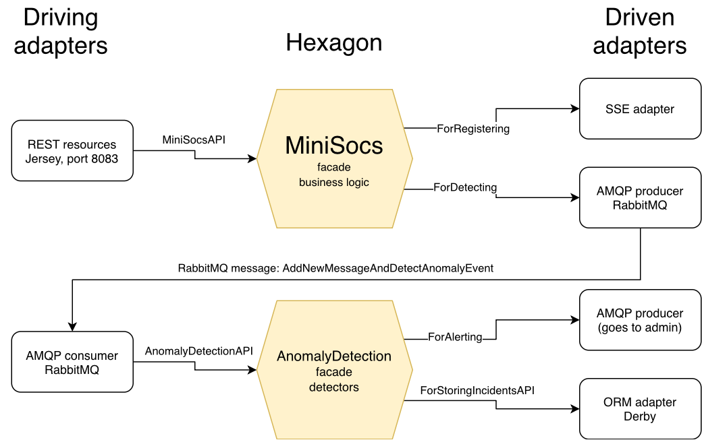

# MiniSocs

A small social network project composed of two Java microservices, which follow the hexagonal (Ports and Adapters) architecture, while communicating with each other using RabbitMQ.

The first microservice, MiniSocs Frontend, holds the logic for user interactions, social networks, members, posts, moderation. It is exposed over REST API, has live notifications support with Server-Sent Events.

The second microservice, Anomaly Detection, is a service that checks the messages for inappropriate vocabulary or long messages, alerts the administrator, stores incidents in database.

A small social network built as two Java microservices, developed for the CSC5002 middleware course at Télécom SudParis (Institut Polytechnique de Paris). Each microservice follows the Ports & Adapters (hexagonal) architecture, and they talk to each other through RabbitMQ.

- **MiniSocs Frontend**: users, social networks, members, posts and moderation. Exposed over REST, with live notifications over Server-Sent Events.
- **Anomaly Detection**: checks every new message (inappropriate vocabulary, overly long messages), alerts the administrator over AMQP, and stores each incident in a database through JPA.

## Architecture



## Tech stack

Java 21 · Maven (multi-module) · JAX-RS (Jersey, Grizzly) · Server-Sent Events · RabbitMQ (AMQP, topic exchange) · JPA (EclipseLink) · Apache Derby · JUnit 5 · Awaitility · Podman

## Prerequisites

- Java 21 and Maven
- Podman (or Docker) to run RabbitMQ

## Build

```bash
mvn clean install
```

This builds every module and runs the unit tests.

## Run

Start RabbitMQ:

```bash
podman run -d --name rabbitmq -p 5672:5672 -p 15672:15672 docker.io/library/rabbitmq:4.1.4-management
```

Start Derby, then Anomaly Detection, then the frontend (each from the project root):

```bash
(cd anomaly-detection/hexagon && ./start_derby_database.sh localhost 1621)
(cd anomaly-detection/startup && ./start_anomalydetection.sh amqp://localhost:5672)
(cd minisocs-frontend/startup && ./start_minisocs.sh http://localhost:8083/MiniSocs http://localhost:8084/MySseServer amqp://localhost:5672)
```

Check that the frontend answers:

```bash
curl http://localhost:8083/MiniSocs/isready
```

Try it:

```bash
curl -X POST -H "Content-Type: text/plain" -d '{"pseudo":"alice","name":"Smith","firstName":"Alice","email":"alice@example.com","strategy":"IMMEDIATE"}' http://localhost:8083/MiniSocs/user/add
curl http://localhost:8083/MiniSocs/user/list
```

Stop everything:

```bash
pkill -f MainMiniSocs
pkill -f MainAnomalyDetection
(cd anomaly-detection/hexagon && ./stop_derby_database.sh localhost 1621)
podman rm -f rabbitmq
```

## Tests

- **Unit tests** run with `mvn clean install`: the hexagon's business rules, the REST and SSE endpoints, and incident storage.
- **Integration and system tests** start RabbitMQ, Derby and the microservices themselves:

```bash
./run_integration_and_system_tests.sh
```

It runs the integration tests of each microservice and client library, then a system test that drives the whole running system through the client library only.

## Credits

The project skeleton, the business logic of both microservices and the build setup were provided by the CSC5002 teaching team at Télécom SudParis. The adapters, startup modules, client libraries and tests were written by Mikayel Sargsyan.
